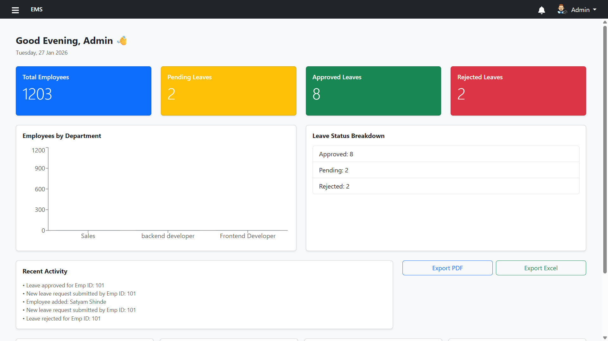
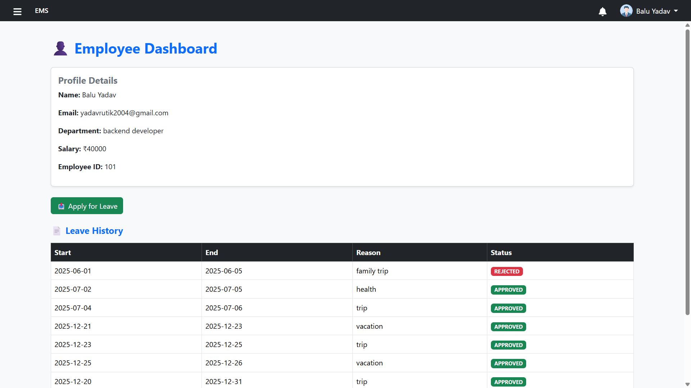
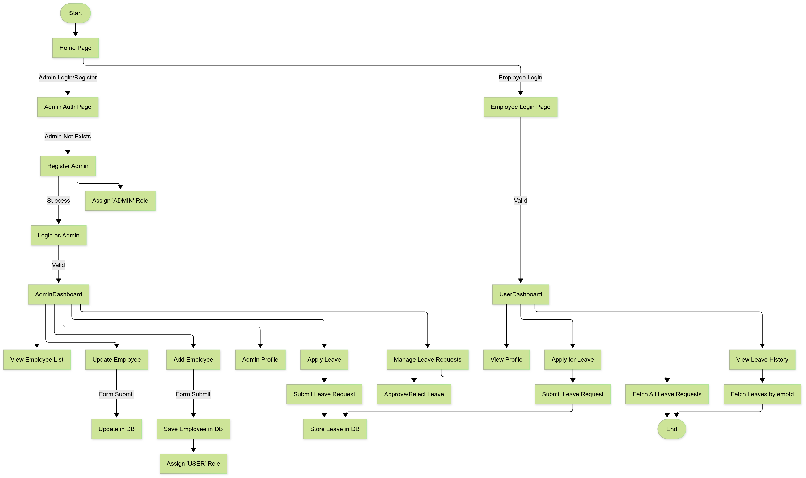
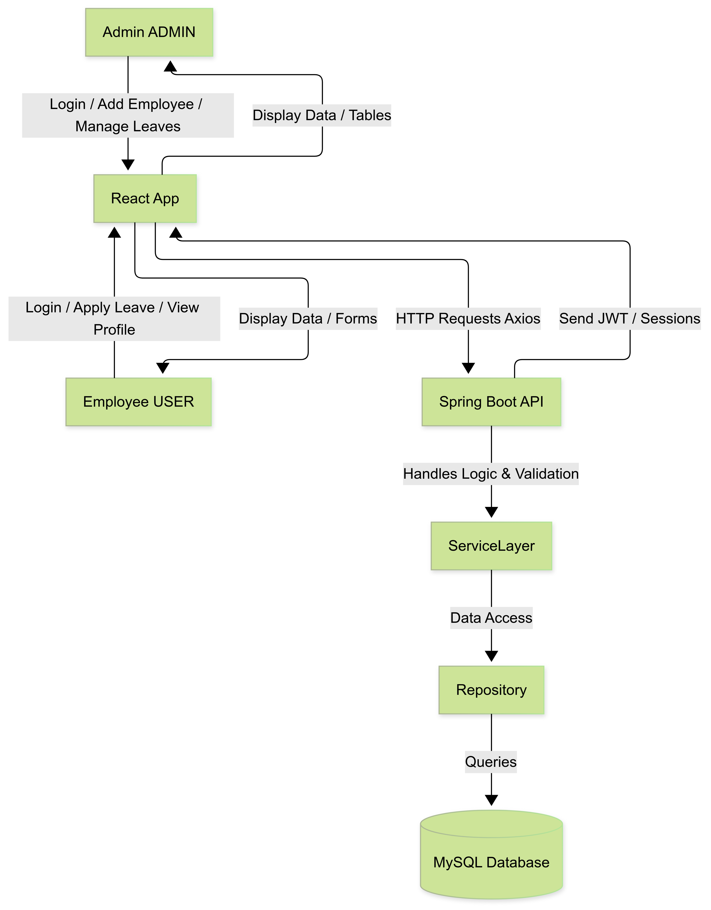

# Tenemsa — Frontend

React 19 + TypeScript + Vite single-page app for Tenemsa.

See the repo root [`README.md`](../README.md) for the full project overview, and [`../docs/`](../docs/) for architecture and API reference.

## Stack

React 19 · TypeScript · Vite · React Router · Recharts · STOMP/SockJS (real-time chat) · Bootstrap 5

TypeScript conversion is complete (see [`../docs/roadmap.md`](../docs/roadmap.md)). The visual rebuild onto Tailwind/shadcn + dark mode is a later, separate roadmap phase — this is still Bootstrap-styled today.

## Local setup

```bash
cp .env.example .env   # defaults to http://localhost:8080
npm install
npm run dev
```

```bash
npm run build       # type-checks (tsc --noEmit) then builds
npm run typecheck   # type-check only, no build
```

## Structure

```
src/
├── pages/            route-level views (admin + shared)
├── components/       admin-side components
├── userComponents/   employee-side components
├── services/         API client, WebSocket client, single source of truth for backend URL
└── types/models.ts   domain types mirroring the backend entities
```

`services/apiConfig.ts` is the only place the backend URL is defined — everything else imports from there. If you're adding a new API call, use `axiosInstance` from `services/axiosInstance.ts` rather than raw `axios`, so auth headers and base URL stay consistent.

## Screenshots

| Admin Panel | User Panel |
|---|---|
|  |  |

| Flow Chart | System Design |
|---|---|
|  |  |

*(Screenshots predate the current backend changes and the Phase 9 visual rebuild — UI structure is accurate, some data/role labels may be stale.)*
